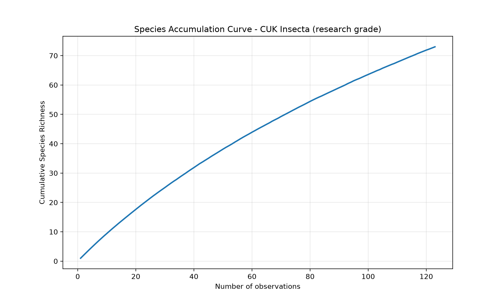

# Estimating insect species richness at CUK from iNaturalist records

I wanted to find out the insect species richness of my university campus: how many species we have discovered and how many are yet to be found. I got this idea from my late night walks and my interest in photographing insects.

## Data

I exported the data on October 29, 2026, from my university's iNaturalist project, Biodiversity of CUK, India. I filtered it to research-grade insect records, which left 123 observations of 73 species.

## Method

To plot how fast new species appear, I shuffled the 123 records into a random order 500 times, counted the cumulative number of distinct species after each record in every shuffle, and averaged the 500 curves. I also used the Chao1 estimator, which estimates the species richness in an environment by using the number of singleton and doubleton observations. For the 95% confidence interval, Chao's log-transformed method was used.

I also ran a sensitivity test by removing the top observer's records, to check whether the results depend on a single observer.

## Results

- Out of 123 observations, 73 were unique species; 46 (63%) were observed only once and 19 (26%) were observed twice.
- Chao1 estimated a total species richness of about 129, with a 95% confidence interval from 99 to 191.
- The accumulation curve (Figure 1) shows a steady rise in species richness with the number of observations, and shows no plateau yet.

- The sensitivity test reduced the dataset from 123 to 78 observations, representing 50 unique species. The Chao1 estimate fell from 129 to about 98. However, the proportion of observed richness relative to estimated richness remained broadly comparable, decreasing from 57% to 51%, while the estimated unobserved proportion increased from 43% to 49%.
- 23 of the 73 species appear only in the top observer's records.

## Limitations

- The sample size was small, and one observer (the top one) provides 37% of the records.
- The data depends on observer bias, because people tend to photograph interesting and beautiful species more (such as butterflies and honey bees).
- Research-grade filtering leaves out observations that are hard to identify.

## How to run

1. Export the project's observations from iNaturalist as CSV and save it as
   `observation.csv` in this folder.
2. Install the packages: `pip install -r requirements.txt`
3. Run: `python analysis.py`

## Credits

Data from the Biodiversity of CUK, India project on iNaturalist, contributed
by its community of observers.

## Full report

[Read the full report (PDF)](report.pdf)
